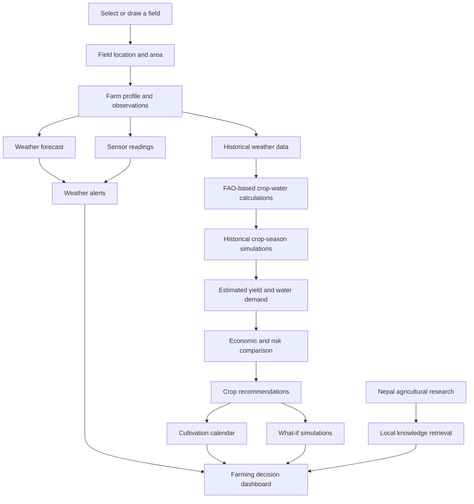
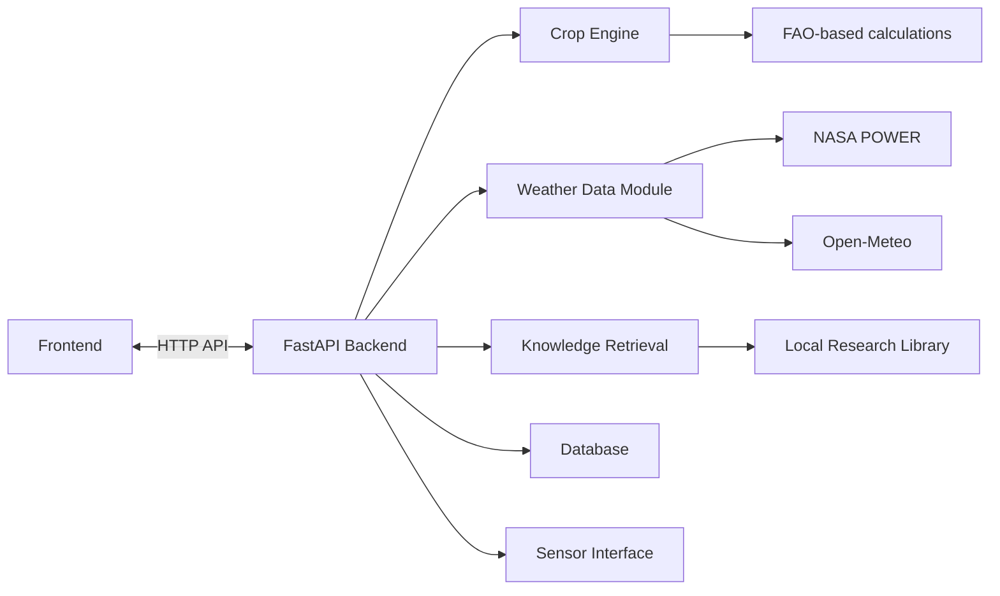

# Arkrishitech 🌱
### Climate-aware agricultural decision support for Nepal

<p align="center">
  
</p>

<p align="center">
  <strong>Making farming decisions more informed through climate data, agricultural science, and local knowledge.</strong>
</p>

<p align="center">
  <a href="https://arckrishitech.vercel.app/">Live Application</a> ·
  <a href="https://github.com/lineo01/Arckrishitech">GitHub Repository</a> ·
  <a href="#how-it-works">How It Works</a> ·
  <a href="#research--data">Research & Data</a>
</p>

---

## 1. About the Project

**Arkrishitech** is an agricultural decision-support platform developed with a focus on farming conditions in Nepal.

It helps farmers explore which crops may be suitable for their fields, when they should consider planting, how weather and water availability could affect crop growth, and how different farming decisions may influence estimated yield and profitability.

The platform brings together historical climate data, weather forecasts, crop-water simulation, field information, sensor observations, agricultural research, and market references.

Rather than relying on a simple crop-season lookup, Arkrishitech evaluates different crops and planting dates against historical weather conditions at a selected location.

Its purpose is to make agricultural planning more localized, understandable, and evidence-informed.

## 2. The Problem

Farming decisions are becoming increasingly difficult as weather patterns change and agricultural resources remain limited.

Farmers may face:

- **Climate uncertainty:** Rainfall and temperature conditions vary between locations and seasons.
- **Uncertain crop selection:** A crop suitable for one region may not perform equally well in another.
- **Water-management challenges:** Poor irrigation planning can expose crops to water stress.
- **Disconnected information:** Weather, market prices, agricultural research, and field observations are often scattered across different sources.
- **Limited access to research:** Valuable scientific and traditional farming knowledge is not always easy to find or apply locally.

Arkrishitech addresses these challenges by bringing relevant information and analytical tools into one farming platform.

## 3. What Arkrishitech Provides

| Component | What it does |
|---|---|
| Field Mapping | Allows farmers to select and draw field boundaries and estimate field area. |
| Climate Dashboard | Presents historical climate information and upcoming weather conditions. |
| Crop Recommendations | Compares crops and planting dates using historical weather simulations. |
| Crop Calendar | Organizes cultivation activities into a practical schedule. |
| Compare & Simulate | Explores how changes in farming inputs and practices affect estimated outcomes. |
| Sensors & Observations | Records soil moisture, soil temperature, and pH observations. |
| Weather Alerts | Highlights potentially important weather and field conditions. |
| Local Research Assistant | Retrieves documented agricultural practices and research relevant to Nepal. |
| Market References | Provides a snapshot of selected wholesale market prices. |

## 4. How It Works

Arkrishitech follows a field-based analytical workflow.

<details>
<summary><strong>View the system workflow</strong></summary>



</details>

### The process

**1. Select a field**

The farmer selects a location and draws the field boundary. The application calculates its approximate geographical area and centre coordinates.

**2. Provide farm information**

The farmer can specify soil type, seed category, irrigation availability, labour, equipment, and other relevant inputs.

**3. Collect climate information**

The backend retrieves historical weather observations from NASA POWER and forecast information from Open-Meteo.

**4. Simulate crop performance**

The crop engine calculates water demand, soil-water availability, stress, and estimated yield for different crops and planting dates.

**5. Compare economic outcomes**

The system estimates production costs, revenue, net returns, and downside risk using its crop and economic assumptions.

**6. Present recommendations**

The application displays ranked crop options, estimated outcomes, cultivation schedules, alerts, and management scenarios.

---

## 5. Crop Recommendation Engine

The crop recommendation engine is the core analytical component of Arkrishitech.

It is implemented in:

`backend/app/engine.py`

The engine uses historical weather data and simplified FAO-based agricultural calculations to simulate crop performance.

### Historical season simulation

The system evaluates candidate sowing dates and replays crop growth across available historical weather records.

For each candidate:

1. It selects a possible sowing date within the crop's configured planting months.
2. It retrieves the corresponding historical daily weather records.
3. It calculates crop water requirements throughout the growth cycle.
4. It simulates soil-water availability and water stress.
5. It estimates yield response and economic outcomes.
6. It compares results across historical years.

The current implementation examines up to 26 candidate dates, spaced 14 days apart, and requires at least eight complete historical runs before ranking a candidate.

**Eight historical runs do not mean eight successful seasons.** Poor-performing seasons are included in the evaluation.

### Scientific calculations

The model uses two important FAO-based methods:

- **FAO-56 Penman–Monteith:** Estimates reference evapotranspiration (ET₀), representing atmospheric water demand.
- **FAO-33 yield-response relationship:** Estimates how water deficits can reduce yield relative to an assumed unstressed yield.

Crop evapotranspiration is estimated using:

\[
ET_c = K_c \times ET_0
\]

The engine also simulates a simplified soil-water balance using rainfall, irrigation, soil characteristics, and crop rooting depth.

### How crops are ranked

The engine considers more than potential yield.

It compares:

- Estimated yield distribution.
- Water requirements and water stress.
- Temperature-related risks.
- Production costs.
- Expected revenue.
- Downside risk.
- Estimated net returns.

The result is a risk-adjusted ranking of crop and planting-date options.

### Important distinction

The crop engine is a deterministic simulation, not a trained machine-learning crop-yield predictor.

Its estimates are based on historical weather, configured crop parameters, and simplified scientific relationships. They are not measured historical farm harvests or guaranteed future yields.

### Currently modelled crop options

The current crop configuration covers eight crop entries, including:

- Finger millet (Kodo)
- Buckwheat (Fapar)
- Maize, beans, and pumpkin mixed cropping
- Lentil (Masuro)
- Mustard (Tori)
- Hill wheat and barley
- Potato (Aalu)
- Turmeric and ginger

The planting windows and model parameters are configurable and require continued regional validation.

---

## 6. Research & Data

Arkrishitech combines three broad types of information:

1. Climate and weather datasets.
2. Scientific agricultural methods.
3. Nepal-focused agricultural research and field observations.

### Climate and weather sources

| Source | Information used | Application |
|---|---|---|
| [NASA POWER](https://power.larc.nasa.gov/) | Historical temperature, rainfall, humidity, wind, and solar radiation | Historical crop-season simulation |
| [Open-Meteo](https://open-meteo.com/) | Short-term weather forecasts | Weather dashboard and near-term alerts |
| [Kalimati market reference](https://ramropatro.com/vegetable) | Selected wholesale vegetable prices | Economic assumptions and market reference |

NASA POWER provides approximately 30 years of historical daily climate data where available. Open-Meteo provides forecasts of up to 16 days.

Historical data and forecast data serve different purposes: historical records drive the crop replay, while forecasts support near-term weather awareness.

### Scientific foundation

The crop engine is informed by:

**FAO-56 — Crop Evapotranspiration**

Allen et al. (1998). FAO Irrigation and Drainage Paper 56.

https://www.fao.org/4/x0490e/x0490e00.htm

Used for reference evapotranspiration and crop-water requirement calculations.

**FAO-33 — Yield Response to Water**

Doorenbos and Kassam (1979). FAO Irrigation and Drainage Paper 33.

https://www.fao.org/4/i2800e/i2800e.pdf

Used as the basis for estimating yield response to water deficits.

### Nepal-focused agricultural research

The local knowledge component draws on research concerning traditional farming practices and agricultural adaptation.

| Research | Location / subject |
|---|---|
| Indigenous agricultural knowledge for climate adaptation (2022) | Khumbu, Nepal |
| Adoption of indigenous agricultural knowledge (2021) | Bhirkot, Syangja |
| Plant-based traditional pest and disease management (2023) | Pokhara-32, Kaski |
| Traditional crop genetic diversity and farmer conservation (2017) | Kailash Sacred Landscape |
| Seed systems of traditional crops in mountain regions (2020) | Humla, Jumla, Lamjung, and Dolakha |

Research references:

- [Khumbu — Frontiers in Climate](https://doi.org/10.3389/fclim.2022.1067630)
- [Bhirkot — Cogent Social Sciences](https://doi.org/10.1080/23311932.2021.1914384)
- [Pokhara — Himalayan Biodiversity](https://doi.org/10.3126/hebids.V9i1.59586)
- [Kailash Sacred Landscape — Journal of Agriculture and Environment](https://www.nepjol.info/index.php/AEJ/article/view/19886/16374)
- [Traditional crop seed systems — Research PDF](https://giwmscdnone.gov.np/media/app/public/75/posts/1685027773_12.pdf)

### How research is used

These studies are not treated as direct crop-yield datasets.

Instead, their documented practices and findings help build a structured local agricultural knowledge library.

The system retrieves relevant information based on the user's question and preserves the source and geographical context of the research.

For example, a traditional moisture-conservation practice documented in Khumbu should not automatically be treated as a universally suitable recommendation for every region of Nepal.

More information:

[`docs/research/NEPAL-LOCAL-KNOWLEDGE-AND-MARKET.md`](docs/research/NEPAL-LOCAL-KNOWLEDGE-AND-MARKET.md)

---

## 7. Application Architecture

Arkrishitech uses a lightweight frontend, a Python backend, external data sources, and a deterministic crop simulation engine.



### Main technology stack

| Layer | Technology |
|---|---|
| Frontend | HTML, CSS, JavaScript |
| Mapping | Leaflet and Leaflet Draw |
| Backend | Python and FastAPI |
| Data validation | Pydantic |
| Crop simulation | Custom Python engine |
| Scientific methods | FAO-56 and FAO-33 concepts |
| Database | SQLite |
| Weather data | NASA POWER and Open-Meteo |
| Knowledge retrieval | Custom Python retrieval system |
| Market reference | JSON snapshot |
| Hosting | Vercel |
| Automation | GitHub Actions |

### Repository structure

```text
Arckrishitech/
│
├── backend/
│   ├── app/
│   │   ├── main.py          # API and application routes
│   │   ├── engine.py        # Crop simulation and recommendations
│   │   ├── data.py          # Climate data retrieval and caching
│   │   ├── db.py            # Database operations
│   │   ├── kb.py            # Local knowledge retrieval
│   │   └── knowledge.json   # Agricultural knowledge records
│   └── tests/
│
├── frontend/                # Frontend application
├── public/                  # Static assets
├── device/
│   └── sketch/              # Arduino firmware
├── docs/
│   └── research/            # Research and market documentation
├── scripts/                 # Data update scripts
├── deploy/                  # Deployment resources
│
├── pyproject.toml
├── requirements.txt
├── DEPLOYMENT.md
├── MARKET-DATA.md
├── README.md
├── run.bat
└── run.sh
```

---

## 8. Field Sensors and Hardware

Arkrishitech includes an interface for recording field observations and integrating physical sensor readings.

The current observation types include:

| Measurement | Unit |
|---|---|
| Soil moisture | % |
| Soil temperature | °C |
| Soil pH | pH scale |

The backend records observations with timestamps and identifies whether the source is manual or device-based.

The repository also contains Arduino firmware under `device/sketch/`.

This allows the project to extend beyond remote climate data by incorporating measurements taken closer to the actual field.

**Sensor integration requires compatible hardware and a working data connection.** A displayed demonstration value should not be interpreted as a real sensor measurement.

---

## 9. Installation and Local Setup

### Requirements

- Python 3.10 or newer.
- Git.
- Internet connection for external climate data.

### Clone the repository

```bash
git clone https://github.com/lineo01/Arckrishitech.git
cd Arckrishitech
```

### Create a virtual environment

**Windows**

```bash
python -m venv .venv
.venv\Scripts\activate
```

**Linux / macOS**

```bash
python3 -m venv .venv
source .venv/bin/activate
```

### Install dependencies

```bash
pip install -r requirements.txt
```

### Start the backend

```bash
uvicorn backend.app.main:app --reload
```

Open the application backend at:

`http://127.0.0.1:8000`

Interactive API documentation:

`http://127.0.0.1:8000/docs`

### Run tests

```bash
KS_OFFLINE=1 pytest -q backend/tests
```

On Windows PowerShell:

```powershell
$env:KS_OFFLINE="1"
pytest -q backend/tests
```

Offline mode is intended for testing and may use synthetic weather data. Such data must not be treated as actual climate observations.

---

## 10. Limitations and Future Development

Arkrishitech is an evolving decision-support project. Its recommendations should be interpreted alongside local agricultural expertise.

Current limitations include:

- Crop parameters and sowing windows require more Nepal-specific validation.
- Historical gridded climate data may differ from actual field-level weather.
- Yield estimates are modelled outcomes, not measured harvest records.
- Market-price coverage is limited, and some crop prices remain assumptions.
- The local research library currently covers selected studies and locations.
- Reliable long-term sensor and field storage requires persistent production infrastructure.

### Planned improvements

- Validate crop parameters using Nepal-specific field trials and NARC research.
- Expand crop coverage and regional suitability data.
- Integrate more physical field sensors.
- Expand the local agricultural knowledge library.
- Improve market-price coverage.
- Validate estimated yields against real farm records.
- Add persistent cloud database storage.
- Introduce Nepali and regional-language support.

---

## 11. Screenshots

Add real application screenshots to `docs/images/` and use the following filenames.

| Screen | Image |
|---|---|
| Main dashboard | `dashboard.png` |
| Field mapping | `field-mapping.png` |
| Crop recommendations | `crop-recommendations.png` |
| Crop calendar | `crop-calendar.png` |
| Compare and simulate | `what-if-simulation.png` |
| Sensors | `sensors.png` |
| Research assistant | `research-assistant.png` |

Example:

```markdown

```

These screenshots should show the actual deployed application, rather than generic interface illustrations.

---

## 12. Contributing

Contributions from developers, agricultural researchers, students, and farming communities are welcome.

To contribute:

1. Fork the repository.
2. Create a feature branch.
3. Make your changes.
4. Test the implementation.
5. Submit a pull request describing your contribution.

Agricultural research contributions should include the original source, geographical scope, crop or practice, and relevant limitations.

Traditional knowledge should be documented with appropriate attribution and community consent.

---

## 13. Acknowledgements

Arkrishitech builds on the work of:

- NASA POWER — Historical meteorological data.
- Open-Meteo — Weather forecast data.
- Food and Agriculture Organization (FAO) — Agricultural and irrigation methodologies.
- Nepal-focused agricultural researchers and farming communities.
- Kalimati wholesale market information providers.

---

<p align="center">
  <strong>Arkrishitech</strong><br>
  Climate-aware decisions. Research-informed farming. Built for Nepal.
</p>

<p align="center">
  <a href="https://arckrishitech.vercel.app/">Explore Arkrishitech</a> ·
  <a href="https://github.com/lineo01/Arckrishitech">View the Source Code</a>
</p>
